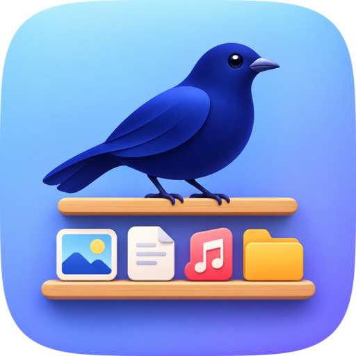
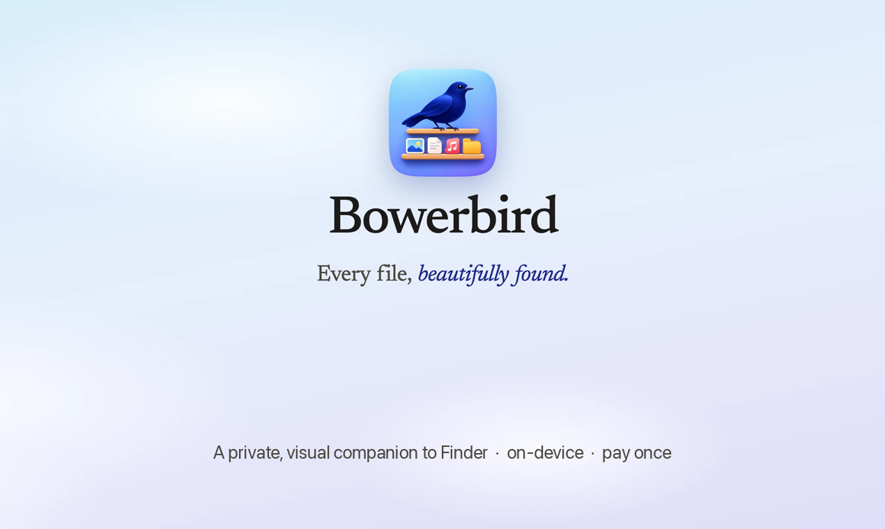
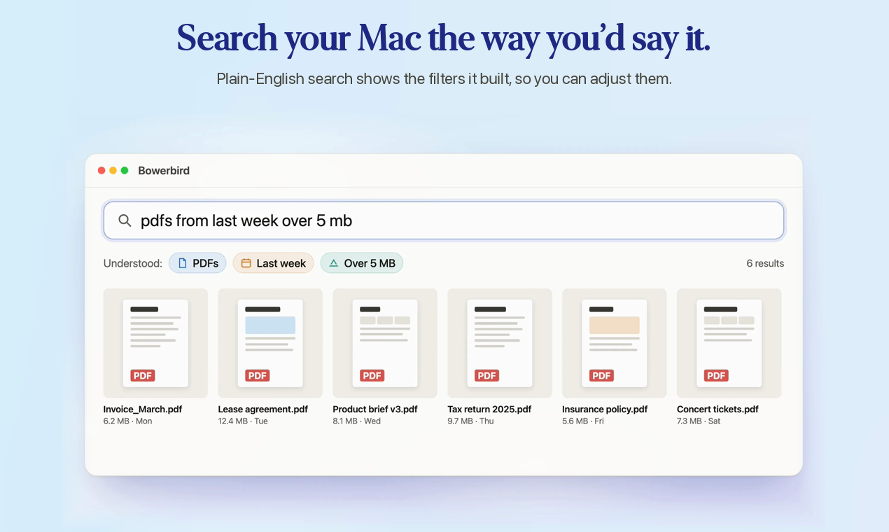
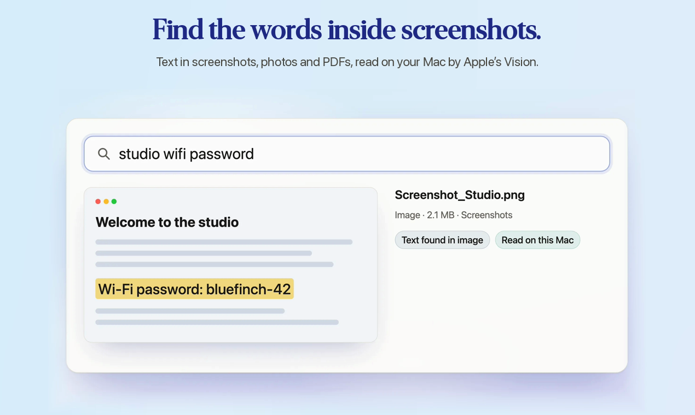
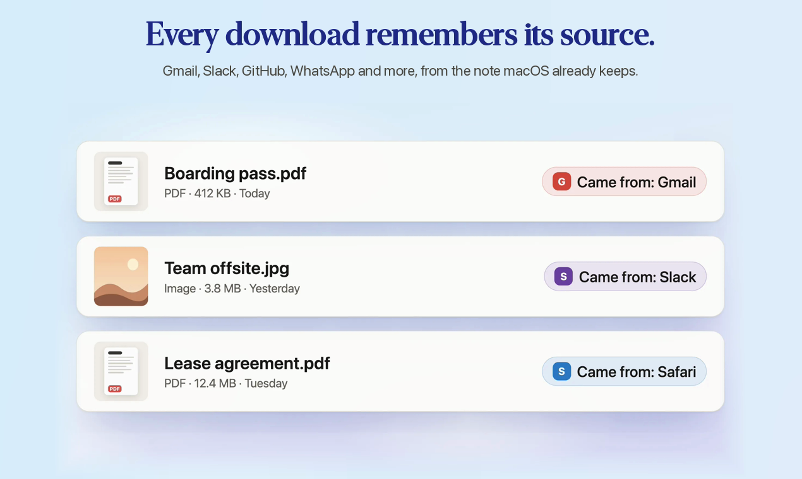
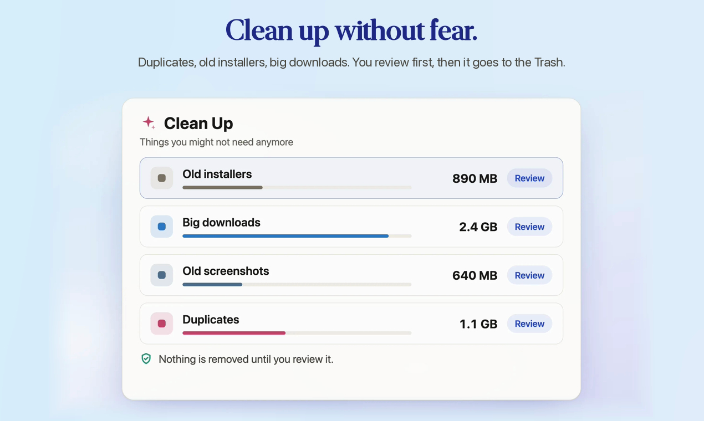
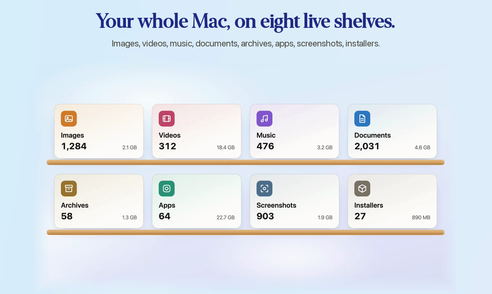

  

<h1 align="center">Bowerbird</h1>

  <b>Find any file on your Mac by what you remember about it.</b> 
  A native Finder companion for macOS. On-device, no account, pay once.

  <a href="https://getbowerbird.app/?ref=github-repo"><b>Download from getbowerbird.app</b></a>
  ·
  <a href="https://www.youtube.com/watch?v=CW5qoJR0QJM">Watch the demo</a>
  ·
  <a href="https://github.com/0xdak/bowerbird-app/issues">Feedback &amp; bug reports</a>

You rarely remember what a file is called. You remember a sentence in a screenshot, the Slack thread it came from, or that it was a PDF from last week. Finder searches names. Bowerbird searches what you remember.

## Features

**Search the way you'd say it.** Type `pdfs from last week over 5 mb` or `images from slack`. Bowerbird shows the filters it built from your sentence, so you can see how it read you and adjust them.

**Find the words inside screenshots.** Text in screenshots, photos and PDFs becomes searchable, using Apple's on-device text recognition.

**Every download remembers its source.** Bowerbird reads the source macOS records for downloads and groups files by where they came from: Gmail, Slack, GitHub, WhatsApp and more.

**Clean up without fear.** Duplicates, look-alike photos, old installers and big forgotten files are grouped with a reason for each. Clean Up only ever moves files to the Trash.

**Your whole Mac on eight live shelves.** Images, videos, documents, installers and more, always up to date.

## Privacy

- Indexing, text recognition and duplicate detection run entirely on your Mac.
- No account. No analytics in the app. Your files, file names and searches never leave your Mac.
- The only network call is license activation.
- Signed and notarized by Apple.

## Requirements

macOS 14 Sonoma or later. Apple silicon and Intel.

## Pricing

One-time purchase, no subscription, all updates included. Launch price for one Mac is $9 for the first 300 licenses. 3-Mac and 5-Mac packs are available. Current prices: [getbowerbird.app](https://getbowerbird.app/?ref=github-repo).

## Bowerbird vs. other Finder alternatives

Bowerbird is not a dual-pane file manager and has no remote connections. It is a companion to Finder for finding, sorting and safely cleaning up everyday files. If you need SFTP or a commander-style layout, see the honest comparison on the blog: [Finder alternatives for Mac](https://getbowerbird.app/blog/finder-alternatives-mac/?ref=github-repo).

## Feedback

Found a bug or want a feature? [Open an issue](https://github.com/0xdak/bowerbird-app/issues). You can also email hello@getbowerbird.app.

This repository holds the public page, screenshots and issue tracker for Bowerbird. The app's source code is not public.
